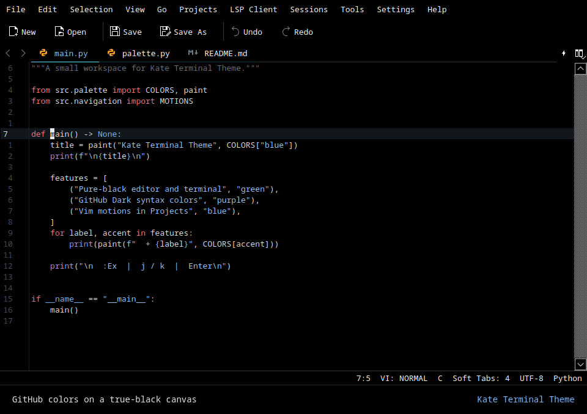

<p align="center">
  
</p>

<h4 align="center">A pure-black Kate setup for Vim users.</h4>

<p align="center">
  <a href="#prerequisites"></a>
  <a href="#prerequisites"></a>
  <a href="#prerequisites"></a>
  <a href="THIRD_PARTY.md"></a>
</p>

---

### Description

A pure-black Kate setup for Vim users: GitHub Dark syntax colors, a compact file tree, a matching terminal panel, and `:Ex` to move between Projects and your code. It stays a lightweight Kate setup, with an optional tmux theme for the terminal.

<p align="center"></p>

## Install

Close Kate before installing so a running instance does not overwrite the new settings on exit.

```sh
git clone https://github.com/nickczak/kate-terminal-theme.git
cd kate-terminal-theme
./install.sh
```

Launch the configured editor from the application menu or directly:

```sh
~/.local/bin/kate
```

The installer builds the plugin for your machine and installs everything into your user directories. It needs no `sudo` after the build dependencies are installed. The cloned repository can be moved or removed afterward.

### Prerequisites

This targets **Linux with Qt 6 / KDE Frameworks 6 Kate**. It needs Python 3, CMake, a C++17 compiler, the Qt 6 Widgets/SVG libraries, and KF6 TextEditor, CoreAddons, and Parts development packages. The installer checks for the terminal-profile API it uses; older KF6 releases may need updating. Qt 5/KF5 Kate, Windows, macOS, and sandboxed Flatpak/Snap packages are not supported by this installer.

On Fedora:

```sh
sudo dnf install python3 kate konsole cmake gcc-c++ extra-cmake-modules \
  qt6-qtbase-devel qt6-qtsvg-devel \
  kf6-ktexteditor-devel kf6-kcoreaddons-devel kf6-kparts-devel \
  google-noto-sans-mono-fonts
```

On Debian/Ubuntu releases that provide Qt 6/KF6 Kate and its development packages:

```sh
sudo apt install python3 kate konsole cmake g++ extra-cmake-modules \
  qt6-base-dev qt6-svg-dev libkf6texteditor-dev \
  libkf6coreaddons-dev libkf6parts-dev fonts-noto-mono
```

On Arch Linux:

```sh
sudo pacman -S --needed python kate konsole cmake gcc extra-cmake-modules \
  qt6-base qt6-svg ktexteditor kcoreaddons kparts noto-fonts
```

If a dependency is missing, installation stops before changing Kate's settings and prints a suggested package command. Build failures are also reported before settings are changed. This has been developed with Kate 26.08.3, Qt 6.11.2, KF6 6.32, and tmux 3.8; other supported installations are built locally rather than using a precompiled plugin.

### Optional tmux theme

```sh
./install.sh --with-tmux
```

This adds a managed include to your tmux configuration. It uses black backgrounds, blue active-pane borders, readable active-window highlights, and a session/window/command/clock status bar. It preserves your shell, key bindings, and existing plugins.

Apply it to an existing tmux session:

```sh
tmux source-file ~/.tmux.conf
```

## Other install options

```sh
./install.sh --check                 # Show prerequisites and paths without changing files
./install.sh --no-icon               # Keep the existing application icon
./install.sh --prefix /tmp/kate-demo  # Install an isolated preview
/tmp/kate-demo/bin/kate              # Launch that preview with its own XDG directories
```

Normal installation respects `XDG_CONFIG_HOME`, `XDG_DATA_HOME`, `XDG_CACHE_HOME`, and `XDG_STATE_HOME`. The launcher is installed in `~/.local/bin`, with a desktop-entry override for the application menu. If your shell still resolves `kate` to `/usr/bin/kate`, use `~/.local/bin/kate` or refresh your shell's command cache after adding `~/.local/bin` to `PATH`.

Re-run `./install.sh` to update. It preserves the original pre-install backups across repeated installs. Rebuild with the same command after a Qt/KDE upgrade if the plugin stops loading.

## License

Original code and assets are MIT licensed. The color schemes retain their upstream licenses and attribution; see [THIRD_PARTY.md](THIRD_PARTY.md).
